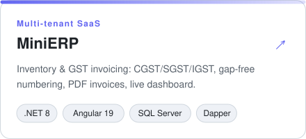
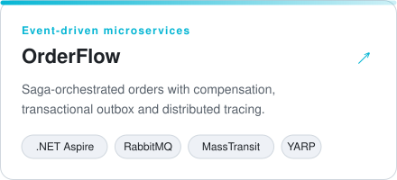
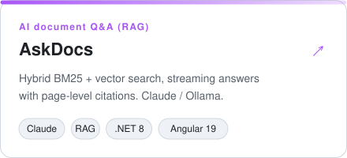
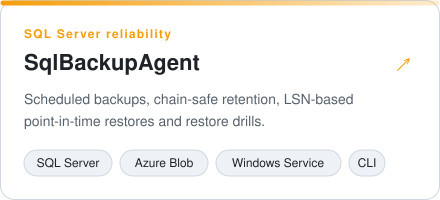
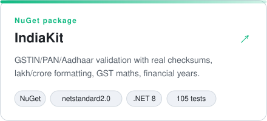

<a href="https://kumarnitish007.github.io/portfolio-master/">
  <picture>
    <source media="(prefers-color-scheme: dark)" srcset="assets/header-dark.svg">
    
  </picture>
</a>

  
  
  
  

### 👋 About me

I'm a **.NET full stack developer with 6+ years** of experience building enterprise **ERP** and **healthcare** systems.
I work end to end: **Angular 19** screens, **.NET 8** Web APIs, and **SQL Server** stored procedures, plus the
production side (IIS, performance diagnosis, CI/CD).

- 🏗️ Currently building EPC ERP modules (procurement, drawings, bidding, dashboards) at **Orient Technology**
- 🏥 Previously delivered healthcare ERPs for **Krsnaa Diagnostic** and the **Assam Government** (ABHA)
- 🧭 I care about clean architecture, honest performance diagnosis and systems that stay maintainable
- 🎓 B.Tech, Maharshi Dayanand University · 🗣️ English, Hindi

### 🚀 Featured projects

Open-source projects built from scratch. Each one has CI, tests against real infrastructure, screenshots and a design-decisions write-up.

<table>
  <tr>
    <td width="50%">
      <a href="https://github.com/KumarNitish007/mini-erp-saas">
        <picture><source media="(prefers-color-scheme: dark)" srcset="assets/project-minierp-dark.svg"></picture>
      </a>
    </td>
    <td width="50%">
      <a href="https://github.com/KumarNitish007/orderflow-microservices">
        <picture><source media="(prefers-color-scheme: dark)" srcset="assets/project-orderflow-dark.svg"></picture>
      </a>
    </td>
  </tr>
  <tr>
    <td width="50%">
      <a href="https://github.com/KumarNitish007/askdocs-rag">
        <picture><source media="(prefers-color-scheme: dark)" srcset="assets/project-askdocs-dark.svg"></picture>
      </a>
    </td>
    <td width="50%">
      <a href="https://github.com/KumarNitish007/sql-backup-agent">
        <picture><source media="(prefers-color-scheme: dark)" srcset="assets/project-sqlbackup-dark.svg"></picture>
      </a>
    </td>
  </tr>
  <tr>
    <td width="50%">
      <a href="https://github.com/KumarNitish007/indiakit">
        <picture><source media="(prefers-color-scheme: dark)" srcset="assets/project-indiakit-dark.svg"></picture>
      </a>
    </td>
    <td width="50%" valign="middle">
      <b>Highlights across these projects</b>  
      ✅ CI on every repo, with tests against real SQL Server, RabbitMQ and Azure Storage emulators 
      🧪 250+ automated tests, including end-to-end and point-in-time restore tests 
      📐 A <code>docs/decisions.md</code> design write-up in each repo 
      🔐 No secrets in source, ever
    </td>
  </tr>
</table>

| Project | Highlights | CI |
|---|---|---|
| [**MiniERP**](https://github.com/KumarNitish007/mini-erp-saas) | Tenant isolation via EF Core filters · GST engine · gap-free invoice numbers in SQL · QuestPDF |  |
| [**OrderFlow**](https://github.com/KumarNitish007/orderflow-microservices) | MassTransit saga · outbox/inbox · database per service · OpenTelemetry · Aspire end-to-end tests |  |
| [**AskDocs**](https://github.com/KumarNitish007/askdocs-rag) | Hybrid search (BM25 + vectors, RRF) · SSE streaming · page citations · Claude / Ollama / offline |  |
| [**SqlBackupAgent**](https://github.com/KumarNitish007/sql-backup-agent) | LSN restore planner · chain-safe retention · restore drills with CHECKDB · Azure Blob |  |
| [**IndiaKit**](https://github.com/KumarNitish007/indiakit) | NuGet package · GSTIN mod-36 & Aadhaar Verhoeff checksums · lakh/crore & amount in words · GST & financial years |  |

> Most of my professional work (ERP, construction-management and healthcare systems) is proprietary, so these public
> projects show the same kind of engineering in the open.

### 🧰 Tech stack

**Backend** 

**Frontend** 

**Data, AI & reporting** 

**Cloud & DevOps** 

### 💼 Experience

<picture>
  <source media="(prefers-color-scheme: dark)" srcset="assets/timeline-dark.svg">
  
</picture>

<b>What I've delivered</b>

- **Orient Technology** (Aug 2024 – present), .NET Developer, EPC ERP: built end-to-end modules (Angular UI → .NET Web API → SQL Server):
  Drawing Master and Release, Critical Issue dashboard, Bid / No-Bid workflow with a weightage engine, and Conference Room & Lunch Booking.
  Implemented single sign-on from the legacy Web Forms portal into Angular without credentials in URLs. Diagnosed slowness as
  network-bound and improved load times with response compression and connection-pool warm-up.
- **Medimaze Solution** (formerly Techjivaa, Jun 2022 – Aug 2024), Software Developer: Krsnaa ERP and Admin Portal, and the
  ABHA healthcare ERP for the Assam Government; Web APIs, MVC front ends and Telerik reports in a 17-member team.
- **Reliance Jio** (Jul 2021 – May 2022), Software Engineer: built the FTTx fibre-rollout portal and Live Tracker for Construction, GIS and Production teams (ASP.NET Core MVC, C#, SQL Server).
- **Glyphisoft Technology** (Jul 2019 – Feb 2021), .NET Developer: ERP modules with ASP.NET Core MVC, C# and SQL Server.

### 🐍 Contribution activity

<picture>
  <source media="(prefers-color-scheme: dark)" srcset="https://raw.githubusercontent.com/KumarNitish007/KumarNitish007/output/github-snake-dark.svg">
  
</picture>

  Hiring for .NET / Angular full stack roles? I'd love to talk: <a href="mailto:nknitish043@gmail.com">nknitish043@gmail.com</a>

